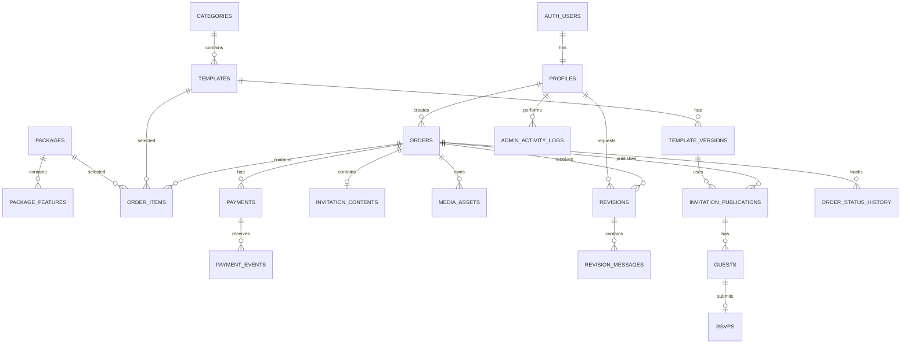

# Database Schema Documentation
## Digital Invitation Service Platform

**Document:** `database-schema.md`  
**Version:** 1.0  
**Database:** PostgreSQL  
**Platform:** Supabase  
**Status:** Initial Database Design  
**Last Updated:** November 2026

---

# 1. Database Overview

## 1.1. Database Architecture

Platform menggunakan PostgreSQL sebagai relational database melalui Supabase.

Database dirancang untuk mengelola:

- User dan role.
- Kategori undangan.
- Template dan versi template.
- Paket layanan.
- Pesanan customer.
- Pembayaran.
- Informasi undangan.
- Media dan file.
- Produksi undangan.
- Revisi.
- Publikasi.
- Daftar tamu.
- RSVP.
- Riwayat aktivitas.

## 1.2. Database Design Principles

Prinsip yang digunakan:

1. Menggunakan UUID sebagai primary key.
2. Menggunakan foreign key untuk menjaga relasi antarentitas.
3. Menggunakan JSONB untuk data undangan yang memiliki struktur berbeda berdasarkan kategori.
4. Memisahkan transaksi pembayaran dari pesanan.
5. Menyimpan snapshot harga dan informasi produk saat pesanan dibuat.
6. Menyimpan versi template untuk menjaga konsistensi undangan.
7. Memisahkan status order, payment, production, dan publication.
8. Menggunakan Row Level Security (RLS) untuk membatasi akses.
9. Menggunakan index untuk meningkatkan performa query.
10. Menyimpan riwayat perubahan status dan aktivitas administrator.

## 1.3. Database Schema Namespace

Seluruh tabel aplikasi utama berada di schema:

```sql
public
```

Supabase Auth menggunakan schema internal `auth`. Tabel `profiles` akan memiliki foreign key ke `auth.users`.

---

# 2. Entity Relationship Diagram (ERD)

## 2.1. Main ERD



## 2.2. Entity Relationships

| Relationship | Description |
|---|---|
| Auth Users - Profiles | Satu akun memiliki satu profil aplikasi |
| Profiles - Orders | Customer dapat memiliki banyak pesanan |
| Categories - Templates | Satu kategori dapat memiliki banyak template |
| Templates - Template Versions | Satu template memiliki banyak versi |
| Packages - Package Features | Satu paket memiliki banyak fitur |
| Orders - Order Items | Satu pesanan dapat memiliki beberapa item |
| Orders - Payments | Satu pesanan dapat memiliki beberapa percobaan pembayaran |
| Payments - Payment Events | Satu pembayaran dapat menerima beberapa event |
| Orders - Invitation Contents | Satu pesanan memiliki maksimal satu data undangan utama |
| Orders - Media Assets | Satu pesanan dapat memiliki banyak file |
| Orders - Revisions | Satu pesanan dapat memiliki banyak permintaan revisi |
| Orders - Publications | Satu pesanan dapat memiliki beberapa riwayat publikasi |
| Publications - Guests | Satu publikasi dapat memiliki banyak tamu |
| Guests - RSVPs | Satu tamu memiliki maksimal satu RSVP aktif |

---

# 3. Database Tables

## 3.1. profiles

Menyimpan informasi profil pengguna aplikasi.

Relasi dengan `auth.users` dari Supabase Auth.

| Column | Type | Description |
|---|---|---|
| id | UUID | PK, FK ke auth.users.id |
| full_name | VARCHAR(150) | Nama pengguna |
| email | VARCHAR(255) | Email pengguna |
| phone | VARCHAR(30) | Nomor telepon |
| avatar_url | TEXT | URL avatar |
| role | VARCHAR(30) | customer, admin, super_admin |
| is_active | BOOLEAN | Status akun |
| created_at | TIMESTAMPTZ | Waktu dibuat |
| updated_at | TIMESTAMPTZ | Waktu diperbarui |

Catatan:
- Role tidak boleh diubah oleh customer.
- Email utama autentikasi tetap dikelola Supabase Auth.
- Role harus divalidasi melalui server dan RLS.

## 3.2. categories

Menyimpan kategori undangan.

| Column | Type | Description |
|---|---|---|
| id | UUID | PK |
| name | VARCHAR(100) | Nama kategori |
| slug | VARCHAR(120) | URL kategori |
| description | TEXT | Deskripsi |
| thumbnail_url | TEXT | Gambar kategori |
| is_active | BOOLEAN | Status kategori |
| sort_order | INTEGER | Urutan tampilan |
| created_at | TIMESTAMPTZ | Waktu dibuat |
| updated_at | TIMESTAMPTZ | Waktu diperbarui |

Contoh data:

| name | slug |
|---|---|
| Wedding | wedding |
| Birthday | birthday |
| Engagement | engagement |
| Corporate | corporate |
| Graduation | graduation |

`slug` harus unik.

## 3.3. templates

Menyimpan informasi utama template.

| Column | Type | Description |
|---|---|---|
| id | UUID | PK |
| category_id | UUID | FK ke categories.id |
| name | VARCHAR(150) | Nama template |
| slug | VARCHAR(150) | Slug template |
| description | TEXT | Deskripsi |
| thumbnail_url | TEXT | Thumbnail |
| demo_url | TEXT | URL demo opsional |
| current_version_id | UUID | FK ke template_versions.id |
| is_active | BOOLEAN | Status template |
| created_at | TIMESTAMPTZ | Waktu dibuat |
| updated_at | TIMESTAMPTZ | Waktu diperbarui |

Template hanya menyimpan metadata. Implementasi desain dan komponen template berada di source code atau sistem template registry.

## 3.4. template_versions

Menyimpan versi desain template.

| Column | Type | Description |
|---|---|---|
| id | UUID | PK |
| template_id | UUID | FK ke templates.id |
| version_number | INTEGER | Nomor versi |
| version_key | VARCHAR(100) | Identitas versi di template registry |
| config | JSONB | Konfigurasi template |
| changelog | TEXT | Catatan perubahan |
| is_active | BOOLEAN | Status versi |
| created_at | TIMESTAMPTZ | Waktu dibuat |

Contoh `version_key`:

```text
wedding/classic-elegant/v1
wedding/classic-elegant/v2
birthday/cute-pastel/v1
```

Aturan:
- Kombinasi `template_id` dan `version_number` harus unik.
- Versi yang telah digunakan oleh publikasi tidak boleh diubah secara destruktif.
- Perubahan desain menghasilkan versi baru.
- `current_version_id` harus menunjuk versi milik template yang sama.

## 3.5. packages

Menyimpan paket layanan yang ditawarkan.

| Column | Type | Description |
|---|---|---|
| id | UUID | PK |
| name | VARCHAR(100) | Nama paket |
| slug | VARCHAR(120) | Slug paket |
| description | TEXT | Deskripsi |
| price | NUMERIC(14,2) | Harga |
| currency | VARCHAR(3) | Mata uang, misalnya IDR |
| revision_limit | INTEGER | Batas revisi |
| duration_days | INTEGER | Masa layanan atau durasi yang dijanjikan |
| is_active | BOOLEAN | Status paket |
| created_at | TIMESTAMPTZ | Waktu dibuat |
| updated_at | TIMESTAMPTZ | Waktu diperbarui |

Harga disimpan sebagai numeric agar tidak mengalami masalah pembulatan floating point.

## 3.6. package_features

Menyimpan daftar fitur setiap paket.

| Column | Type | Description |
|---|---|---|
| id | UUID | PK |
| package_id | UUID | FK ke packages.id |
| feature_name | VARCHAR(150) | Nama fitur |
| feature_value | TEXT | Nilai atau deskripsi |
| is_included | BOOLEAN | Apakah fitur termasuk |
| sort_order | INTEGER | Urutan fitur |

Contoh:

| Package | Feature | Value |
|---|---|---|
| Basic | RSVP | Included |
| Premium | Music | Included |
| Premium | Gallery | Unlimited |
| Exclusive | Custom Design | Included |

---

# 4. Order Management

## 4.1. orders

Tabel utama transaksi customer.

| Column | Type | Description |
|---|---|---|
| id | UUID | PK |
| order_number | VARCHAR(40) | Nomor pesanan unik |
| customer_id | UUID | FK ke profiles.id |
| status | VARCHAR(30) | Status pesanan |
| subtotal | NUMERIC(14,2) | Total sebelum diskon |
| discount_amount | NUMERIC(14,2) | Potongan harga |
| total_amount | NUMERIC(14,2) | Total akhir |
| currency | VARCHAR(3) | Mata uang |
| customer_notes | TEXT | Catatan customer |
| expires_at | TIMESTAMPTZ | Batas pembayaran |
| paid_at | TIMESTAMPTZ | Waktu pembayaran berhasil |
| completed_at | TIMESTAMPTZ | Waktu pesanan selesai |
| created_at | TIMESTAMPTZ | Waktu dibuat |
| updated_at | TIMESTAMPTZ | Waktu diperbarui |

Contoh nomor pesanan:

```text
INV-2026-000001
INV-2026-000002
INV-2026-000003
```

`order_number` harus unik.

Status order:

```text
pending_payment
paid
processing
completed
cancelled
expired
```

Status order tidak menggantikan status pembayaran maupun produksi.

## 4.2. order_items

Menyimpan detail item yang dipilih dalam pesanan.

| Column | Type | Description |
|---|---|---|
| id | UUID | PK |
| order_id | UUID | FK ke orders.id |
| template_id | UUID | FK ke templates.id |
| package_id | UUID | FK ke packages.id |
| template_version_id | UUID | FK ke template_versions.id |
| template_name_snapshot | VARCHAR(150) | Nama template saat order |
| package_name_snapshot | VARCHAR(100) | Nama paket saat order |
| unit_price | NUMERIC(14,2) | Harga saat order |
| quantity | INTEGER | Jumlah |
| subtotal | NUMERIC(14,2) | Subtotal item |
| package_snapshot | JSONB | Snapshot detail paket |
| created_at | TIMESTAMPTZ | Waktu dibuat |

Mengapa snapshot diperlukan?

Misalnya:
- Customer membeli paket Premium seharga Rp150.000.
- Beberapa bulan kemudian harga berubah menjadi Rp200.000.
- Pesanan lama harus tetap menggunakan harga Rp150.000.

Data snapshot memastikan transaksi lama tidak terpengaruh perubahan katalog.

---

# 5. Payment Management

## 5.1. payments

Menyimpan percobaan pembayaran untuk setiap order.

| Column | Type | Description |
|---|---|---|
| id | UUID | PK |
| order_id | UUID | FK ke orders.id |
| payment_method | VARCHAR(30) | bank_transfer, gateway |
| provider | VARCHAR(50) | Nama provider |
| provider_transaction_id | VARCHAR(255) | ID transaksi eksternal |
| amount | NUMERIC(14,2) | Nominal pembayaran |
| currency | VARCHAR(3) | Mata uang |
| status | VARCHAR(30) | Status pembayaran |
| payment_url | TEXT | URL pembayaran |
| proof_storage_path | TEXT | Path bukti transfer |
| verified_by | UUID | FK ke profiles.id |
| verified_at | TIMESTAMPTZ | Waktu verifikasi |
| paid_at | TIMESTAMPTZ | Waktu berhasil |
| expires_at | TIMESTAMPTZ | Batas pembayaran |
| created_at | TIMESTAMPTZ | Waktu dibuat |
| updated_at | TIMESTAMPTZ | Waktu diperbarui |

Status:

```text
pending
waiting_verification
paid
failed
expired
refunded
```

Aturan:
- Satu order dapat memiliki banyak payment attempts.
- Payment attempt yang gagal tidak menghapus order.
- Pembayaran manual memerlukan verifikasi administrator.
- Pembayaran gateway harus dikonfirmasi melalui webhook yang valid.
- Hanya pembayaran yang berhasil dan valid yang dapat mengubah status order menjadi paid.

## 5.2. payment_events

Mencatat event dari payment gateway.

| Column | Type | Description |
|---|---|---|
| id | UUID | PK |
| payment_id | UUID | FK ke payments.id |
| provider_event_id | VARCHAR(255) | ID event provider |
| event_type | VARCHAR(100) | Jenis event |
| payload | JSONB | Payload webhook |
| signature_valid | BOOLEAN | Hasil validasi signature |
| processed_at | TIMESTAMPTZ | Waktu diproses |
| processing_status | VARCHAR(30) | Status pemrosesan |
| created_at | TIMESTAMPTZ | Waktu diterima |

`provider_event_id` harus unik untuk mencegah pemrosesan event yang sama lebih dari satu kali.

Payload harus dibatasi aksesnya karena dapat memuat informasi transaksi.

---

# 6. Invitation Management

## 6.1. invitation_contents

Menyimpan informasi undangan yang dikirim customer dan diproses administrator.

| Column | Type | Description |
|---|---|---|
| id | UUID | PK |
| order_id | UUID | FK ke orders.id, UNIQUE |
| category_id | UUID | FK ke categories.id |
| content_json | JSONB | Data undangan |
| production_json | JSONB | Data hasil konfigurasi admin |
| submission_status | VARCHAR(30) | Status pengumpulan data |
| submitted_at | TIMESTAMPTZ | Waktu dikirim customer |
| reviewed_at | TIMESTAMPTZ | Waktu diperiksa admin |
| reviewed_by | UUID | FK ke profiles.id |
| created_at | TIMESTAMPTZ | Waktu dibuat |
| updated_at | TIMESTAMPTZ | Waktu diperbarui |

Contoh `content_json` untuk kategori wedding:

```json
{
  "groom": {
    "name": "Bergas Ahmad",
    "parents": "Bapak A dan Ibu B"
  },
  "bride": {
    "name": "Nadia Putri",
    "parents": "Bapak C dan Ibu D"
  },
  "events": [
    {
      "type": "akad",
      "date": "2026-12-20",
      "time": "09:00",
      "location": "Jakarta"
    },
    {
      "type": "reception",
      "date": "2026-12-20",
      "time": "11:00",
      "location": "Jakarta"
    }
  ],
  "story": [],
  "music": {
    "enabled": true
  }
}
```

Contoh `content_json` untuk kategori birthday:

```json
{
  "person": {
    "name": "Andi",
    "age": 17
  },
  "event": {
    "date": "2026-12-20",
    "time": "19:00",
    "location": "Jakarta"
  },
  "theme": "pastel"
}
```

Struktur JSONB dapat berkembang sesuai kategori.

Namun, data penting tetap perlu divalidasi menggunakan schema validation di aplikasi.

## 6.2. media_assets

Menyimpan metadata file yang diunggah customer atau administrator.

| Column | Type | Description |
|---|---|---|
| id | UUID | PK |
| order_id | UUID | FK ke orders.id |
| uploaded_by | UUID | FK ke profiles.id |
| file_name | VARCHAR(255) | Nama file |
| storage_bucket | VARCHAR(100) | Nama bucket |
| storage_path | TEXT | Path file |
| mime_type | VARCHAR(100) | Tipe file |
| file_size | BIGINT | Ukuran file |
| asset_type | VARCHAR(30) | image, audio, document |
| visibility | VARCHAR(20) | private, public |
| created_at | TIMESTAMPTZ | Waktu dibuat |

File tidak disimpan langsung sebagai binary di PostgreSQL.

Database hanya menyimpan metadata dan lokasi file di Supabase Storage.

---

# 7. Production & Revision Management

## 7.1. revisions

Mencatat permintaan revisi dari customer.

| Column | Type | Description |
|---|---|---|
| id | UUID | PK |
| order_id | UUID | FK ke orders.id |
| requested_by | UUID | FK ke profiles.id |
| revision_number | INTEGER | Nomor revisi |
| description | TEXT | Deskripsi revisi |
| status | VARCHAR(30) | Status revisi |
| assigned_to | UUID | FK ke profiles.id |
| completed_at | TIMESTAMPTZ | Waktu selesai |
| created_at | TIMESTAMPTZ | Waktu dibuat |
| updated_at | TIMESTAMPTZ | Waktu diperbarui |

Status:

```text
requested
accepted
in_progress
completed
rejected
```

Batas revisi harus diperiksa berdasarkan snapshot paket yang dibeli, bukan berdasarkan harga paket saat ini.

## 7.2. revision_messages

Menyimpan komunikasi terkait revisi.

| Column | Type | Description |
|---|---|---|
| id | UUID | PK |
| revision_id | UUID | FK ke revisions.id |
| sender_id | UUID | FK ke profiles.id |
| message | TEXT | Isi pesan |
| attachments | JSONB | Referensi lampiran |
| created_at | TIMESTAMPTZ | Waktu dibuat |

Pesan revisi harus dapat diakses oleh customer pemilik order dan administrator yang memiliki izin.

---

# 8. Publication Management

## 8.1. invitation_publications

Menyimpan versi undangan yang telah dipublikasikan.

| Column | Type | Description |
|---|---|---|
| id | UUID | PK |
| order_id | UUID | FK ke orders.id |
| template_version_id | UUID | FK ke template_versions.id |
| slug | VARCHAR(180) | URL undangan |
| content_snapshot | JSONB | Snapshot konten |
| template_config_snapshot | JSONB | Snapshot konfigurasi template |
| status | VARCHAR(30) | Status publikasi |
| published_at | TIMESTAMPTZ | Waktu publikasi |
| expires_at | TIMESTAMPTZ | Waktu kedaluwarsa |
| unpublished_at | TIMESTAMPTZ | Waktu tidak aktif |
| created_at | TIMESTAMPTZ | Waktu dibuat |

Contoh:

```text
https://domain.com/bergas-nadia
https://domain.com/ulang-tahun-andi
```

Aturan:
- Slug harus unik secara global.
- Slug hanya menggunakan karakter yang diizinkan.
- Slug tidak boleh menggunakan reserved routes.
- Publikasi baru harus menyimpan snapshot konten dan konfigurasi.
- Perubahan template tidak boleh mengubah publikasi lama.
- Riwayat publikasi sebelumnya tetap dapat disimpan.

## 8.2. Slug Reserved Words

Contoh slug yang tidak boleh digunakan:

```text
admin
customer
api
templates
pricing
about
contact
services
login
register
dashboard
settings
```

Daftar reserved words sebaiknya dikelola melalui konfigurasi aplikasi atau tabel khusus.

---

# 9. Guest & RSVP Management

## 9.1. guests

Menyimpan daftar tamu undangan.

| Column | Type | Description |
|---|---|---|
| id | UUID | PK |
| publication_id | UUID | FK ke invitation_publications.id |
| guest_name | VARCHAR(150) | Nama tamu |
| guest_token_hash | TEXT | Hash token personal |
| phone | VARCHAR(30) | Nomor telepon opsional |
| invitation_group | VARCHAR(100) | Grup tamu |
| created_at | TIMESTAMPTZ | Waktu dibuat |
| updated_at | TIMESTAMPTZ | Waktu diperbarui |

Token personal tidak boleh disimpan dalam bentuk plaintext.

## 9.2. rsvps

Menyimpan jawaban RSVP.

| Column | Type | Description |
|---|---|---|
| id | UUID | PK |
| guest_id | UUID | FK ke guests.id, UNIQUE |
| attendance_status | VARCHAR(30) | attending, not_attending, maybe |
| guest_count | INTEGER | Jumlah kehadiran |
| message | TEXT | Ucapan |
| submitted_at | TIMESTAMPTZ | Waktu dikirim |
| updated_at | TIMESTAMPTZ | Waktu diperbarui |

Jika undangan mendukung RSVP publik tanpa daftar tamu sebelumnya, desain dapat diperluas dengan `publication_id` pada tabel RSVP dan kolom `guest_id` nullable.

Untuk implementasi awal, RSVP sebaiknya menggunakan daftar tamu yang telah dibuat atau token undangan yang valid.

---

# 10. Audit & History

## 10.1. order_status_history

Menyimpan perubahan status pesanan.

| Column | Type | Description |
|---|---|---|
| id | UUID | PK |
| order_id | UUID | FK ke orders.id |
| old_status | VARCHAR(30) | Status sebelumnya |
| new_status | VARCHAR(30) | Status baru |
| changed_by | UUID | FK ke profiles.id |
| notes | TEXT | Catatan perubahan |
| created_at | TIMESTAMPTZ | Waktu perubahan |

Riwayat status tidak boleh dihapus atau diubah oleh customer.

## 10.2. admin_activity_logs

Mencatat aktivitas penting administrator.

| Column | Type | Description |
|---|---|---|
| id | UUID | PK |
| actor_id | UUID | FK ke profiles.id |
| action | VARCHAR(100) | Jenis aktivitas |
| entity_type | VARCHAR(100) | Jenis entitas |
| entity_id | UUID | ID entitas |
| metadata | JSONB | Detail aktivitas |
| ip_address | INET | IP address |
| user_agent | TEXT | Informasi browser |
| created_at | TIMESTAMPTZ | Waktu aktivitas |

Contoh aktivitas:

```text
ORDER_STATUS_UPDATED
PAYMENT_VERIFIED
TEMPLATE_CREATED
TEMPLATE_UPDATED
INVITATION_PUBLISHED
INVITATION_UNPUBLISHED
CUSTOMER_ACCOUNT_UPDATED
```

Log harus bersifat append-only untuk pengguna aplikasi biasa.

---

# 11. Database Constraints

Constraint digunakan untuk menjaga integritas data.

## 11.1. Primary Key

Semua tabel utama menggunakan:

```sql
id UUID PRIMARY KEY DEFAULT gen_random_uuid()
```

## 11.2. Foreign Key

Gunakan foreign key untuk menjaga hubungan antartabel.

Contoh:

```sql
customer_id UUID NOT NULL
REFERENCES public.profiles(id)
```

Aturan penghapusan harus dipertimbangkan per entitas.

Rekomendasi:
- Jangan menghapus customer yang sudah memiliki transaksi.
- Jangan menghapus template yang sudah digunakan order.
- Jangan menghapus paket yang sudah digunakan order.
- Gunakan soft delete atau `is_active` untuk data katalog.
- Hapus data turunan secara cascade hanya jika memang aman.

## 11.3. Unique Constraints

Contoh:

```sql
UNIQUE (order_number)
UNIQUE (slug)
UNIQUE (template_id, version_number)
UNIQUE (provider_event_id)
UNIQUE (guest_id)
```

Unique constraint pada `provider_event_id` sebaiknya menggunakan kombinasi provider dan event ID jika provider yang berbeda dapat menghasilkan ID event yang sama.

## 11.4. Check Constraints

Contoh:

```sql
CHECK (price >= 0)
CHECK (total_amount >= 0)
CHECK (quantity > 0)
CHECK (file_size >= 0)
CHECK (revision_number > 0)
CHECK (guest_count > 0)
```

Status juga harus dibatasi melalui CHECK constraint atau PostgreSQL enum. Untuk MVP, `VARCHAR` dengan CHECK constraint dapat mempermudah evolusi status.

---

# 12. Database Indexing

Index diperlukan untuk query yang sering dilakukan.

Rekomendasi awal:

| Table | Column | Index Type | Purpose |
|---|---|---|---|
| profiles | role | B-tree | Filter role |
| categories | slug | Unique | Pencarian kategori |
| categories | is_active, sort_order | B-tree | Katalog kategori |
| templates | category_id, is_active | B-tree | Filter template |
| templates | slug | Unique | Detail template |
| template_versions | template_id, version_number | Unique | Versi template |
| orders | order_number | Unique | Pencarian pesanan |
| orders | customer_id, created_at | B-tree | Pesanan customer |
| orders | status, created_at | B-tree | Dashboard admin |
| payments | order_id, created_at | B-tree | Riwayat pembayaran |
| payments | provider_transaction_id | B-tree | Pencarian transaksi |
| payment_events | provider_event_id | Unique | Idempotency |
| invitation_contents | order_id | Unique | Data undangan |
| media_assets | order_id, created_at | B-tree | Media pesanan |
| revisions | order_id, created_at | B-tree | Riwayat revisi |
| invitation_publications | slug | Unique | Resolusi URL |
| invitation_publications | status, expires_at | B-tree | Publikasi aktif |
| guests | publication_id | B-tree | Daftar tamu |
| rsvps | guest_id | Unique | RSVP tamu |

Index tambahan harus didasarkan pada query aktual dan hasil pengukuran performa.

Jangan membuat index untuk setiap kolom secara otomatis karena index juga menambah biaya penyimpanan dan penulisan.

---

# 13. Row Level Security (RLS)

RLS wajib diaktifkan untuk tabel yang dapat diakses melalui Supabase client.

## 13.1. Role Access Matrix

| Resource | Visitor | Customer | Admin | Super Admin |
|---|---|---|---|---|
| Public categories | Read | Read | CRUD | CRUD |
| Active templates | Read | Read | CRUD | CRUD |
| Own profile | - | Read/Update | Read | Read |
| Own orders | - | Read/Create | Read/Update | Full |
| Own payments | - | Read/Create | Read/Verify | Full |
| Own invitation data | - | Read/Create/Update | Read/Update | Full |
| Own media | - | Upload/Read | Read/Manage | Full |
| Revisions | - | Own | Manage | Full |
| Publications | Public read | Own read | Manage | Full |
| Guests / RSVP | Public submission | Own read | Manage | Full |
| Audit logs | - | - | Limited | Full |

Hak akses final harus disesuaikan dengan kebijakan operasional dan kebutuhan privasi.

## 13.2. RLS Implementation Principles

1. Customer hanya dapat mengakses data miliknya.
2. Customer tidak dapat mengubah role sendiri.
3. Customer tidak dapat memverifikasi pembayaran.
4. Customer tidak dapat mengubah status publikasi.
5. Admin hanya mendapatkan akses sesuai role.
6. Super Admin dapat mengelola konfigurasi sistem.
7. Data pembayaran dan log tidak dapat dimodifikasi customer.
8. Akses publik hanya diberikan kepada data yang memang harus ditampilkan.

Pemeriksaan role harus menggunakan data yang dipercaya server/database, bukan metadata yang dapat diubah pengguna.

## 13.3. Example RLS: Profiles

```sql
ALTER TABLE public.profiles ENABLE ROW LEVEL SECURITY;

CREATE POLICY "Users can read own profile"
ON public.profiles
FOR SELECT
TO authenticated
USING (id = (SELECT auth.uid()));

CREATE POLICY "Users can update own profile"
ON public.profiles
FOR UPDATE
TO authenticated
USING (id = (SELECT auth.uid()))
WITH CHECK (id = (SELECT auth.uid()));
```

Kebijakan update harus dilengkapi pembatasan agar customer tidak dapat mengubah kolom `role` atau kolom administratif lainnya. Cara yang disarankan adalah membatasi kolom melalui server-side update function atau grant privilege yang sesuai.

## 13.4. Example RLS: Orders

```sql
ALTER TABLE public.orders ENABLE ROW LEVEL SECURITY;

CREATE POLICY "Customer can read own orders"
ON public.orders
FOR SELECT
TO authenticated
USING (
    customer_id = (SELECT auth.uid())
);
```

Pembuatan dan perubahan order sebaiknya dilakukan melalui server-side business logic agar customer tidak dapat menentukan sendiri total harga maupun status pesanan.

## 13.5. Example RLS: Invitation Contents

```sql
ALTER TABLE public.invitation_contents
ENABLE ROW LEVEL SECURITY;

CREATE POLICY "Customer can read own invitation content"
ON public.invitation_contents
FOR SELECT
TO authenticated
USING (
    EXISTS (
        SELECT 1
        FROM public.orders o
        WHERE o.id = invitation_contents.order_id
        AND o.customer_id = (SELECT auth.uid())
    )
);
```

Kebijakan insert dan update harus memeriksa kepemilikan order serta status proses yang diperbolehkan.

## 13.6. Admin Authorization

Jangan mengandalkan pemeriksaan role dari frontend.

Untuk operasi administrator:
- Periksa role di server.
- Gunakan database function atau helper yang aman untuk pemeriksaan role.
- Hindari policy yang melakukan query rekursif ke tabel yang juga sedang diperiksa.
- Jangan menerima role dari request browser sebagai sumber otoritas.
- Service role key hanya digunakan di server.

Contoh konsep helper:

```sql
CREATE OR REPLACE FUNCTION public.has_admin_role()
RETURNS BOOLEAN
LANGUAGE SQL
STABLE
SECURITY DEFINER
SET search_path = ''
AS $$
    SELECT EXISTS (
        SELECT 1
        FROM public.profiles
        WHERE id = (SELECT auth.uid())
        AND role IN ('admin', 'super_admin')
        AND is_active = true
    );
$$;
```

Fungsi tersebut harus dimiliki role database yang tepat dan diberi permission execute secara terbatas. Pastikan tidak ada jalur eskalasi hak akses melalui fungsi tersebut.

Contoh policy:

```sql
CREATE POLICY "Admins can read orders"
ON public.orders
FOR SELECT
TO authenticated
USING (public.has_admin_role());
```

Policy tambahan untuk INSERT, UPDATE, dan DELETE harus dibuat secara terpisah sesuai kebutuhan.

## 13.7. Storage RLS

Bucket yang direkomendasikan:

```text
customer-uploads
payment-proofs
invitation-assets
template-previews
```

Rekomendasi:

| Bucket | Visibility | Access |
|---|---|---|
| customer-uploads | Private | Pemilik order dan admin |
| payment-proofs | Private | Pemilik order dan admin |
| invitation-assets | Public atau private sesuai kebutuhan | Aset publikasi |
| template-previews | Public | Visitor dan customer |

Path file sebaiknya memiliki struktur:

```text
customer-uploads/{user_id}/{order_id}/{filename}
payment-proofs/{user_id}/{order_id}/{filename}
invitation-assets/{order_id}/{filename}
template-previews/{template_id}/{filename}
```

Policy Storage harus memvalidasi kepemilikan file melalui path dan relasi order, bukan hanya mengandalkan nama folder.

---

# 14. Initial SQL Migration

Bagian ini merupakan contoh fondasi migration awal. Implementasi produksi perlu dilengkapi dengan seluruh tabel, constraint, policy, dan trigger yang telah dijelaskan di atas.

## 14.1. Enable Extensions

```sql
CREATE EXTENSION IF NOT EXISTS pgcrypto;
```

## 14.2. Profiles

```sql
CREATE TABLE public.profiles (
    id UUID PRIMARY KEY REFERENCES auth.users(id)
        ON DELETE CASCADE,

    full_name VARCHAR(150),
    email VARCHAR(255),
    phone VARCHAR(30),
    avatar_url TEXT,

    role VARCHAR(30) NOT NULL DEFAULT 'customer'
        CHECK (role IN ('customer', 'admin', 'super_admin')),

    is_active BOOLEAN NOT NULL DEFAULT TRUE,

    created_at TIMESTAMPTZ NOT NULL DEFAULT NOW(),
    updated_at TIMESTAMPTZ NOT NULL DEFAULT NOW()
);
```

## 14.3. Categories

```sql
CREATE TABLE public.categories (
    id UUID PRIMARY KEY DEFAULT gen_random_uuid(),

    name VARCHAR(100) NOT NULL,
    slug VARCHAR(120) NOT NULL UNIQUE,
    description TEXT,
    thumbnail_url TEXT,

    is_active BOOLEAN NOT NULL DEFAULT TRUE,
    sort_order INTEGER NOT NULL DEFAULT 0,

    created_at TIMESTAMPTZ NOT NULL DEFAULT NOW(),
    updated_at TIMESTAMPTZ NOT NULL DEFAULT NOW()
);
```

## 14.4. Templates

```sql
CREATE TABLE public.templates (
    id UUID PRIMARY KEY DEFAULT gen_random_uuid(),

    category_id UUID NOT NULL
        REFERENCES public.categories(id)
        ON DELETE RESTRICT,

    name VARCHAR(150) NOT NULL,
    slug VARCHAR(150) NOT NULL UNIQUE,
    description TEXT,
    thumbnail_url TEXT,
    demo_url TEXT,

    current_version_id UUID,

    is_active BOOLEAN NOT NULL DEFAULT TRUE,

    created_at TIMESTAMPTZ NOT NULL DEFAULT NOW(),
    updated_at TIMESTAMPTZ NOT NULL DEFAULT NOW()
);
```

## 14.5. Template Versions

```sql
CREATE TABLE public.template_versions (
    id UUID PRIMARY KEY DEFAULT gen_random_uuid(),

    template_id UUID NOT NULL
        REFERENCES public.templates(id)
        ON DELETE RESTRICT,

    version_number INTEGER NOT NULL,
    version_key VARCHAR(100) NOT NULL,
    config JSONB NOT NULL DEFAULT '{}'::jsonb,
    changelog TEXT,

    is_active BOOLEAN NOT NULL DEFAULT TRUE,

    created_at TIMESTAMPTZ NOT NULL DEFAULT NOW(),

    UNIQUE (template_id, version_number),
    UNIQUE (template_id, version_key)
);
```

Tambahkan foreign key untuk `current_version_id` setelah kedua tabel tersedia:

```sql
ALTER TABLE public.templates
ADD CONSTRAINT fk_templates_current_version
FOREIGN KEY (current_version_id)
REFERENCES public.template_versions(id)
ON DELETE RESTRICT;
```

Validasi tambahan diperlukan untuk memastikan current version memang milik template yang bersangkutan.

## 14.6. Packages

```sql
CREATE TABLE public.packages (
    id UUID PRIMARY KEY DEFAULT gen_random_uuid(),

    name VARCHAR(100) NOT NULL,
    slug VARCHAR(120) NOT NULL UNIQUE,
    description TEXT,

    price NUMERIC(14,2) NOT NULL
        CHECK (price >= 0),

    currency VARCHAR(3) NOT NULL DEFAULT 'IDR',

    revision_limit INTEGER NOT NULL DEFAULT 0
        CHECK (revision_limit >= 0),

    duration_days INTEGER,

    is_active BOOLEAN NOT NULL DEFAULT TRUE,

    created_at TIMESTAMPTZ NOT NULL DEFAULT NOW(),
    updated_at TIMESTAMPTZ NOT NULL DEFAULT NOW()
);
```

## 14.7. Orders

```sql
CREATE TABLE public.orders (
    id UUID PRIMARY KEY DEFAULT gen_random_uuid(),

    order_number VARCHAR(40) NOT NULL UNIQUE,

    customer_id UUID NOT NULL
        REFERENCES public.profiles(id)
        ON DELETE RESTRICT,

    status VARCHAR(30) NOT NULL DEFAULT 'pending_payment'
        CHECK (
            status IN (
                'pending_payment',
                'paid',
                'processing',
                'completed',
                'cancelled',
                'expired'
            )
        ),

    subtotal NUMERIC(14,2) NOT NULL DEFAULT 0
        CHECK (subtotal >= 0),

    discount_amount NUMERIC(14,2) NOT NULL DEFAULT 0
        CHECK (discount_amount >= 0),

    total_amount NUMERIC(14,2) NOT NULL
        CHECK (total_amount >= 0),

    currency VARCHAR(3) NOT NULL DEFAULT 'IDR',

    customer_notes TEXT,

    expires_at TIMESTAMPTZ,
    paid_at TIMESTAMPTZ,
    completed_at TIMESTAMPTZ,

    created_at TIMESTAMPTZ NOT NULL DEFAULT NOW(),
    updated_at TIMESTAMPTZ NOT NULL DEFAULT NOW()
);
```

## 14.8. Payments

```sql
CREATE TABLE public.payments (
    id UUID PRIMARY KEY DEFAULT gen_random_uuid(),

    order_id UUID NOT NULL
        REFERENCES public.orders(id)
        ON DELETE RESTRICT,

    payment_method VARCHAR(30) NOT NULL
        CHECK (payment_method IN ('bank_transfer', 'gateway')),

    provider VARCHAR(50),
    provider_transaction_id VARCHAR(255),

    amount NUMERIC(14,2) NOT NULL
        CHECK (amount >= 0),

    currency VARCHAR(3) NOT NULL DEFAULT 'IDR',

    status VARCHAR(30) NOT NULL DEFAULT 'pending'
        CHECK (
            status IN (
                'pending',
                'waiting_verification',
                'paid',
                'failed',
                'expired',
                'refunded'
            )
        ),

    payment_url TEXT,
    proof_storage_path TEXT,

    verified_by UUID REFERENCES public.profiles(id),
    verified_at TIMESTAMPTZ,
    paid_at TIMESTAMPTZ,
    expires_at TIMESTAMPTZ,

    created_at TIMESTAMPTZ NOT NULL DEFAULT NOW(),
    updated_at TIMESTAMPTZ NOT NULL DEFAULT NOW()
);
```

## 14.9. Invitation Contents

```sql
CREATE TABLE public.invitation_contents (
    id UUID PRIMARY KEY DEFAULT gen_random_uuid(),

    order_id UUID NOT NULL UNIQUE
        REFERENCES public.orders(id)
        ON DELETE RESTRICT,

    category_id UUID NOT NULL
        REFERENCES public.categories(id)
        ON DELETE RESTRICT,

    content_json JSONB NOT NULL DEFAULT '{}'::jsonb,
    production_json JSONB NOT NULL DEFAULT '{}'::jsonb,

    submission_status VARCHAR(30) NOT NULL DEFAULT 'draft'
        CHECK (
            submission_status IN (
                'draft',
                'submitted',
                'in_review',
                'incomplete',
                'approved'
            )
        ),

    submitted_at TIMESTAMPTZ,
    reviewed_at TIMESTAMPTZ,
    reviewed_by UUID REFERENCES public.profiles(id),

    created_at TIMESTAMPTZ NOT NULL DEFAULT NOW(),
    updated_at TIMESTAMPTZ NOT NULL DEFAULT NOW()
);
```

## 14.10. Invitation Publications

```sql
CREATE TABLE public.invitation_publications (
    id UUID PRIMARY KEY DEFAULT gen_random_uuid(),

    order_id UUID NOT NULL
        REFERENCES public.orders(id)
        ON DELETE RESTRICT,

    template_version_id UUID NOT NULL
        REFERENCES public.template_versions(id)
        ON DELETE RESTRICT,

    slug VARCHAR(180) NOT NULL UNIQUE,

    content_snapshot JSONB NOT NULL,
    template_config_snapshot JSONB NOT NULL,

    status VARCHAR(30) NOT NULL DEFAULT 'draft'
        CHECK (
            status IN (
                'draft',
                'published',
                'unpublished',
                'expired'
            )
        ),

    published_at TIMESTAMPTZ,
    expires_at TIMESTAMPTZ,
    unpublished_at TIMESTAMPTZ,

    created_at TIMESTAMPTZ NOT NULL DEFAULT NOW()
);
```

## 14.11. Indexes

```sql
CREATE INDEX idx_orders_customer_created
ON public.orders (customer_id, created_at DESC);

CREATE INDEX idx_orders_status_created
ON public.orders (status, created_at DESC);

CREATE INDEX idx_payments_order_created
ON public.payments (order_id, created_at DESC);

CREATE INDEX idx_templates_category_active
ON public.templates (category_id, is_active);

CREATE INDEX idx_publications_status_expiry
ON public.invitation_publications (status, expires_at);

CREATE INDEX idx_invitation_contents_json
ON public.invitation_contents
USING GIN (content_json);
```

GIN index untuk JSONB hanya perlu ditambahkan apabila query memang sering melakukan pencarian berdasarkan isi JSONB.

---

# 15. Database Triggers & Functions

## 15.1. Updated At Trigger

Tabel yang memiliki `updated_at` perlu diperbarui secara otomatis.

```sql
CREATE OR REPLACE FUNCTION public.set_updated_at()
RETURNS TRIGGER
LANGUAGE plpgsql
AS $$
BEGIN
    NEW.updated_at = NOW();
    RETURN NEW;
END;
$$;
```

Contoh penerapan:

```sql
CREATE TRIGGER set_profiles_updated_at
BEFORE UPDATE ON public.profiles
FOR EACH ROW
EXECUTE FUNCTION public.set_updated_at();

CREATE TRIGGER set_orders_updated_at
BEFORE UPDATE ON public.orders
FOR EACH ROW
EXECUTE FUNCTION public.set_updated_at();

CREATE TRIGGER set_payments_updated_at
BEFORE UPDATE ON public.payments
FOR EACH ROW
EXECUTE FUNCTION public.set_updated_at();
```

Trigger yang sama dapat diterapkan ke tabel lain yang memiliki `updated_at`.

## 15.2. Profile Creation Trigger

Profil dapat dibuat secara otomatis setelah user berhasil mendaftar melalui Supabase Auth.

```sql
CREATE OR REPLACE FUNCTION public.handle_new_user()
RETURNS TRIGGER
LANGUAGE plpgsql
SECURITY DEFINER
SET search_path = ''
AS $$
BEGIN
    INSERT INTO public.profiles (
        id,
        full_name,
        email,
        role
    )
    VALUES (
        NEW.id,
        NEW.raw_user_meta_data ->> 'full_name',
        NEW.email,
        'customer'
    );

    RETURN NEW;
END;
$$;

CREATE TRIGGER on_auth_user_created
AFTER INSERT ON auth.users
FOR EACH ROW
EXECUTE FUNCTION public.handle_new_user();
```

Role selalu ditetapkan menjadi `customer` pada proses registrasi publik. Metadata dari browser tidak boleh digunakan untuk menetapkan role administrator.

---

# 16. Data Integrity & Business Rules

Aturan penting yang harus diterapkan pada database dan business logic:

## 16.1. Order

- Customer harus memiliki profil aktif.
- Nomor order harus unik.
- Total harga dihitung di server.
- Harga item disimpan sebagai snapshot.
- Order yang sudah dibayar tidak boleh kembali ke status pending tanpa proses khusus.

## 16.2. Payment

- Payment harus terkait dengan order yang valid.
- Nominal payment harus sesuai tagihan.
- Event webhook harus diproses secara idempotent.
- Verifikasi pembayaran manual harus mencatat administrator.
- Status paid tidak boleh ditetapkan hanya berdasarkan redirect browser.

## 16.3. Invitation

- Data undangan hanya dapat dikirim oleh pemilik order atau administrator.
- Produksi hanya dapat dimulai setelah persyaratan pembayaran terpenuhi.
- Data yang telah disetujui perlu memiliki versi atau snapshot.

## 16.4. Publication

- Slug harus unik.
- Publikasi harus menggunakan template version yang valid.
- Konten publikasi harus disimpan sebagai snapshot.
- Hanya publikasi dengan status published yang boleh diakses publik.
- Perubahan pada draft tidak boleh langsung mengubah publikasi aktif.

## 16.5. RSVP

- RSVP harus terkait dengan publikasi yang valid.
- Guest token harus diverifikasi.
- Jumlah kehadiran harus bernilai positif.
- Endpoint RSVP harus memiliki rate limiting.

---

# 17. Migration Strategy

Database dikembangkan menggunakan Supabase CLI dan migration SQL.

Contoh struktur:

```text
supabase/
├── migrations/
│   ├── 20261103000100_create_profiles.sql
│   ├── 20261103000200_create_categories.sql
│   ├── 20261103000300_create_templates.sql
│   ├── 20261103000400_create_template_versions.sql
│   ├── 20261103000500_create_packages.sql
│   ├── 20261103000600_create_orders.sql
│   ├── 20261103000700_create_payments.sql
│   ├── 20261103000800_create_invitations.sql
│   ├── 20261103000900_create_revisions.sql
│   ├── 20261103001000_create_publications.sql
│   ├── 20261103001100_create_guests_rsvps.sql
│   ├── 20261103001200_create_audit_logs.sql
│   ├── 20261103001300_create_indexes.sql
│   ├── 20261103001400_create_triggers.sql
│   └── 20261103001500_enable_rls.sql
│
├── seed.sql
└── config.toml
```

Migration harus dijalankan secara berurutan.

Prinsip migration:
- Jangan mengedit migration yang sudah diterapkan di environment bersama.
- Buat migration baru untuk perubahan schema.
- Uji migration di local terlebih dahulu.
- Gunakan backup sebelum perubahan besar di production.
- Sertakan rollback plan untuk perubahan yang berisiko.

---

# 18. Database Testing Checklist

Sebelum production, lakukan pengujian:

## User & Authentication

- [ ] User baru mendapatkan profil customer.
- [ ] Customer tidak dapat mengubah role.
- [ ] User tidak dapat membaca profil privat pengguna lain.
- [ ] Admin hanya dapat melakukan operasi sesuai kewenangan.

## Categories & Templates

- [ ] Slug kategori unik.
- [ ] Slug template unik.
- [ ] Template dapat memiliki beberapa versi.
- [ ] Template lama tidak mengubah publikasi sebelumnya.

## Orders

- [ ] Customer dapat membuat order.
- [ ] Customer hanya dapat membaca order sendiri.
- [ ] Total harga tidak dapat dimanipulasi melalui browser.
- [ ] Perubahan harga paket tidak memengaruhi order lama.

## Payments

- [ ] Satu order dapat memiliki beberapa payment attempts.
- [ ] Bukti transfer hanya dapat diakses pihak berwenang.
- [ ] Webhook duplikat tidak memproses pembayaran dua kali.
- [ ] Pembayaran gagal tidak menghapus order.

## Invitation Production

- [ ] Customer hanya dapat mengubah data undangan miliknya.
- [ ] Admin dapat melakukan review.
- [ ] Revisi mengikuti batas paket.
- [ ] Snapshot publikasi tetap konsisten.

## Publication & RSVP

- [ ] Slug publikasi unik.
- [ ] Publikasi draft tidak dapat diakses publik.
- [ ] Publikasi aktif dapat diakses melalui slug.
- [ ] RSVP tidak dapat dikirim untuk publikasi yang tidak valid.
- [ ] Guest token tidak mengekspos informasi pribadi.

## Storage & Security

- [ ] Customer tidak dapat membaca file customer lain.
- [ ] Payment proof bersifat private.
- [ ] File upload memiliki batas ukuran dan tipe.
- [ ] Service role key tidak tersedia di frontend.

---

# 19. Future Database Improvements

Pengembangan lanjutan dapat menambahkan:

- Coupons dan discount codes.
- Customer reviews.
- Notification history.
- Scheduled publication.
- Invitation analytics.
- Guest import/export.
- Custom domain management.
- Subscription atau recurring services.
- Refund management.
- Multiple admin teams.
- Production task assignment.
- Payment reconciliation.

Penambahan tabel dilakukan ketika kebutuhan bisnis sudah jelas dan fitur MVP telah stabil.

---

# 20. Related Documentation

| File | Description |
|---|---|
| `system-doc.md` | Arsitektur keseluruhan sistem |
| `user-flow.md` | Alur visitor, customer, admin, dan guest |
| `api-documentation.md` | API dan kontrak request/response |
| `security.md` | Authentication, authorization, RLS, dan keamanan |
| `deployment.md` | Environment, migration, CI/CD, deployment |
| `development-roadmap.md` | Tahapan pengembangan |
| `README.md` | Instalasi dan cara menjalankan project |

---

**End of Document**
