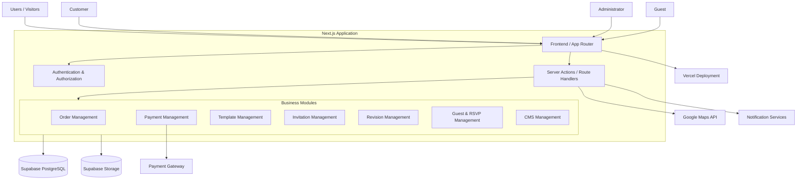
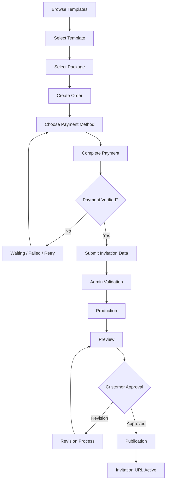

# System Documentation
## Digital Invitation Service Platform

**Document:** `system-doc.md`  
**Project:** Digital Invitation Service Platform  
**Version:** 1.0  
**Status:** Initial Architecture  
**Last Updated:** November 2026

---

# 1. Project Overview

## 1.1. Deskripsi Project

Digital Invitation Service Platform merupakan platform bisnis jasa pembuatan undangan digital berbasis website.

Platform ini memungkinkan calon pelanggan melihat katalog template undangan, memilih desain, memesan layanan, melakukan pembayaran, mengisi informasi acara, dan memantau proses pembuatan undangan melalui customer portal.

Berbeda dengan platform undangan digital berbasis self-service website builder, sistem ini menggunakan model operasional **hybrid service**.

Customer bertanggung jawab memberikan informasi acara dan materi pendukung, sedangkan administrator bertanggung jawab atas proses produksi, penyesuaian desain, pemeriksaan kualitas, dan publikasi undangan.

## 1.2. Business Model

Sistem menggunakan model bisnis jasa dengan alur:

1. Customer memilih template dan paket layanan.
2. Customer membuat pesanan.
3. Customer melakukan pembayaran.
4. Customer mengisi formulir informasi acara.
5. Admin melakukan validasi data.
6. Admin mengerjakan dan menyesuaikan desain undangan.
7. Admin menyediakan preview kepada customer.
8. Customer dapat meminta revisi sesuai ketentuan paket.
9. Admin memublikasikan undangan.
10. Customer menerima URL undangan yang dapat dibagikan.

## 1.3. Project Objectives

- Menyediakan katalog undangan digital yang dapat dikelola melalui CMS.
- Mempermudah proses pemesanan dan pembayaran.
- Menyediakan customer portal untuk memantau pesanan.
- Menyediakan admin dashboard untuk mengelola produksi.
- Mendukung berbagai kategori undangan.
- Menyediakan sistem publikasi undangan melalui URL unik.
- Mengelola RSVP dan daftar tamu secara terintegrasi.
- Mempermudah pengembangan template undangan baru.

## 1.4. Target Categories

Sistem dirancang untuk mendukung berbagai kategori:

| Kategori | Contoh |
|---|---|
| Wedding | Pernikahan |
| Engagement | Pertunangan |
| Birthday | Ulang tahun |
| Corporate | Acara perusahaan |
| Graduation | Wisuda |
| Event | Seminar, gathering, dan acara umum |
| Custom | Kategori khusus |

Kategori tidak dibuat secara hardcoded. Admin dapat mengelola kategori melalui dashboard.

---

# 2. System Architecture

## 2.1. Architecture Overview

Sistem menggunakan pendekatan **Modular Monolith Architecture**.

Seluruh aplikasi utama berada dalam satu codebase Next.js, tetapi setiap domain bisnis dipisahkan ke dalam modul yang memiliki tanggung jawab masing-masing.

Pendekatan ini dipilih karena:
- Lebih sederhana untuk dikembangkan dan dipelihara.
- Tidak membutuhkan infrastruktur microservices.
- Mendukung pengembangan fitur secara modular.
- Cocok untuk tahap MVP dan pertumbuhan bisnis.
- Mempermudah deployment melalui Vercel.

## 2.2. High-Level Architecture



## 2.3. Main Application Components

### A. Public Website

Website yang dapat diakses tanpa login.

Fungsi:
- Landing page.
- Informasi layanan.
- Katalog template.
- Detail dan demo template.
- Daftar harga.
- FAQ.
- Contact page.

### B. Customer Portal

Area khusus customer yang sudah melakukan registrasi atau login.

Fungsi:
- Dashboard customer.
- Melihat daftar pesanan.
- Melihat status pembayaran.
- Mengunggah bukti pembayaran.
- Mengisi informasi undangan.
- Mengunggah foto dan media.
- Melihat preview undangan.
- Mengajukan revisi.
- Mengakses undangan yang telah dipublikasikan.

### C. Admin Dashboard

Area operasional untuk administrator.

Fungsi:
- Dashboard statistik.
- Mengelola pesanan.
- Memverifikasi pembayaran.
- Mengelola customer.
- Mengelola kategori.
- Mengelola template.
- Mengelola paket layanan.
- Mengelola produksi undangan.
- Mengelola revisi.
- Melakukan publikasi.
- Mengelola RSVP.
- Melihat laporan dan aktivitas admin.

### D. Public Invitation Renderer

Komponen yang bertanggung jawab menampilkan undangan digital yang sudah dipublikasikan.

Contoh URL:

```text
https://domain.com/bergas-nadia
https://domain.com/ulang-tahun-andi
https://domain.com/company-gathering-2026
```

Renderer mengambil data publikasi berdasarkan slug, menentukan versi template yang digunakan, kemudian menampilkan undangan.

---

# 3. Technology Stack

## 3.1. Core Technology

| Layer | Technology | Responsibility |
|---|---|---|
| Frontend | Next.js | Web application |
| Language | TypeScript | Type safety |
| UI | Tailwind CSS | Styling |
| Components | shadcn/ui | UI components |
| Backend | Next.js Server Actions & Route Handlers | Server-side business logic |
| Database | Supabase PostgreSQL | Relational database |
| Authentication | Supabase Auth | User authentication |
| Storage | Supabase Storage | Media and file storage |
| Deployment | Vercel | Application hosting |
| DNS / CDN | Cloudflare | DNS and edge services |

## 3.2. External Services

| Service | Purpose |
|---|---|
| Midtrans / Xendit | Payment gateway |
| Google Maps API | Location and map integration |
| Email provider | Transactional notifications |
| WhatsApp | Customer communication |
| Sentry | Error monitoring |
| Vercel Analytics | Application analytics |

External integrations should be implemented through dedicated service modules so providers can be replaced without changing the main business logic.

---

# 4. Application Structure

## 4.1. Application Areas

The application is divided into four main areas:

```text
/
├── Public Website
├── Customer Portal
├── Admin Dashboard
└── Public Invitation Renderer
```

## 4.2. Route Structure

### Public Website

```text
/
├── /about
├── /services
├── /templates
├── /templates/[category]
├── /templates/[slug]
├── /pricing
├── /faq
└── /contact
```

### Customer Portal

```text
/customer
├── /dashboard
├── /orders
├── /orders/[orderId]
├── /orders/[orderId]/payment
├── /orders/[orderId]/form
├── /orders/[orderId]/preview
├── /orders/[orderId]/revision
├── /profile
└── /settings
```

### Admin Dashboard

```text
/admin
├── /dashboard
├── /orders
├── /orders/[orderId]
├── /production
├── /templates
├── /templates/[templateId]
├── /categories
├── /packages
├── /customers
├── /payments
├── /invitations
├── /revisions
├── /guests
├── /analytics
└── /settings
```

### Public Invitation

```text
/[slug]
```

The dynamic invitation route must exclude reserved application paths such as `admin`, `customer`, `templates`, `pricing`, and `api`.

---

# 5. User Roles & Permissions

The system uses role-based access control (RBAC).

## 5.1. Visitor

Unauthenticated user.

Permissions:
- Access public website.
- Browse categories.
- Browse templates.
- View template demos.
- View pricing.
- Create an account.
- Create an order through the permitted checkout flow.

## 5.2. Customer

Registered user.

Permissions:
- Manage own profile.
- Create and view own orders.
- Make payments.
- Upload payment proof.
- Submit invitation information.
- Upload invitation media.
- View own invitation preview.
- Request revisions.
- Access published invitation.

Customer must not access other customers' orders or private files.

## 5.3. Admin

Operational administrator.

Permissions:
- Manage orders.
- Verify manual payments.
- Manage invitation production.
- Manage templates and categories.
- Manage packages.
- Review customer submissions.
- Perform revisions.
- Publish invitations.
- Manage guest and RSVP data.
- View operational reports.

## 5.4. Super Admin

Administrator with elevated permissions.

Permissions:
- All admin permissions.
- Manage administrator accounts.
- Manage system configuration.
- Manage payment provider settings.
- Access audit logs.
- Manage sensitive operational settings.

## 5.5. Guest

Visitor of a published invitation.

Permissions:
- View public invitation.
- Submit RSVP.
- Send wishes or messages.
- Access permitted guest-specific invitation links.

Guest does not need an application account.

---

# 6. Core Business Modules

Each business domain is implemented as an independent module inside the modular monolith.

## 6.1. Authentication Module

Responsibilities:
- Registration.
- Login and logout.
- Session management.
- Password recovery.
- Role management.
- Route protection.

Authentication is handled by Supabase Auth.

Authorization is enforced on the server and through Supabase Row Level Security.

## 6.2. Category Management Module

Responsibilities:
- Create categories.
- Update categories.
- Delete or archive categories.
- Manage category descriptions.
- Manage category slugs.
- Associate templates with categories.

Categories must be database-driven.

## 6.3. Template Management Module

Responsibilities:
- Create templates.
- Update template metadata.
- Upload preview images.
- Associate templates with categories.
- Manage template versions.
- Configure template components.
- Activate or deactivate templates.

### Template Versioning

Published invitations must not change unexpectedly when an administrator updates a template.

Each invitation publication must reference a specific template version.

A template update creates a new version rather than silently modifying the version used by existing publications.

## 6.4. Package Management Module

Responsibilities:
- Create service packages.
- Configure prices.
- Configure package features.
- Configure revision limits.
- Configure service limitations.
- Activate or deactivate packages.

The system stores price snapshots when an order is created.

Changes to current package prices must not affect existing orders.

## 6.5. Order Management Module

Responsibilities:
- Create orders.
- Generate order numbers.
- Associate customers with orders.
- Associate templates and packages.
- Calculate prices.
- Track order status.
- Maintain order history.

The server must calculate the final price. Browser-submitted prices must never be trusted.

## 6.6. Payment Management Module

The system supports two payment methods.

**Manual bank transfer**
- Customer receives payment instructions.
- Customer uploads payment proof.
- Admin verifies payment.
- Payment status is updated.

**Payment gateway**
- Server creates a transaction.
- Customer completes payment through the provider.
- Provider sends a webhook.
- Server verifies webhook authenticity.
- Payment status is updated.

Payment events must be processed idempotently to prevent duplicate payment processing.

Payment attempts are separate from orders so customers can retry payment without creating duplicate orders.

## 6.7. Invitation Data Module

Responsibilities:
- Provide dynamic category-based forms.
- Store event information.
- Store customer-submitted content.
- Store media references.
- Validate submitted data.
- Provide structured data to the production process.

Invitation data should support JSONB for category-specific content, while important relational fields remain in normalized database columns.

## 6.8. Production Module

This module manages the actual creation of invitations.

Workflow:
1. Admin receives a paid order.
2. Admin checks submitted information.
3. Admin requests missing information if necessary.
4. Admin starts production.
5. Admin selects the appropriate template version.
6. Admin configures content and design.
7. Admin generates a preview.
8. Admin submits the preview for customer review.

The system should distinguish between customer-submitted content and administrator-produced content.

## 6.9. Revision Module

Responsibilities:
- Receive revision requests.
- Store revision descriptions.
- Track revision counts.
- Track revision status.
- Associate revisions with orders.
- Maintain revision history.

Revision limits depend on the selected service package.

## 6.10. Publication Module

Responsibilities:
- Generate invitation slug.
- Validate slug uniqueness.
- Publish invitation.
- Store publication snapshot.
- Activate public invitation URL.
- Unpublish or archive invitations.

Publication must reference the exact template version and content snapshot used.

## 6.11. Guest & RSVP Module

Responsibilities:
- Store guest records.
- Manage RSVP responses.
- Store attendance information.
- Store guest wishes.
- Provide guest statistics.
- Support personalized invitation links.

Personalized URLs should use opaque tokens rather than exposing private guest information in query parameters.

## 6.12. Notification Module

Notification events include:

```text
ORDER_CREATED
PAYMENT_CONFIRMED
DATA_SUBMITTED
DATA_INCOMPLETE
PRODUCTION_STARTED
PREVIEW_READY
REVISION_REQUESTED
REVISION_COMPLETED
INVITATION_PUBLISHED
INVITATION_EXPIRING
```

Initial implementation can use dashboard notifications, email, and manually generated WhatsApp links.

Automated WhatsApp Business API integration can be introduced later.

---

# 7. Order & Production Lifecycle

## 7.1. Customer Order Lifecycle



## 7.2. Independent Status Domains

Order, payment, production, and publication statuses must be stored independently.

This avoids mixing financial state with production progress.

Suggested initial status values:

**Order**
```text
pending_payment
paid
processing
completed
cancelled
expired
```

**Payment**
```text
pending
waiting_verification
paid
failed
expired
refunded
```

**Production**
```text
waiting_data
data_review
queued
in_progress
preview_ready
revision_requested
approved
completed
```

**Publication**
```text
draft
published
unpublished
expired
```

Status transitions must be validated by server-side business logic.

---

# 8. Data Architecture

## 8.1. Main Database Entities

The database uses PostgreSQL through Supabase.

Main entities:

| Entity | Responsibility |
|---|---|
| profiles | User profiles and roles |
| categories | Invitation categories |
| templates | Template metadata |
| template_versions | Template version history |
| packages | Service packages |
| package_features | Package feature definitions |
| orders | Customer orders |
| order_items | Products or services within orders |
| payments | Payment attempts |
| payment_events | Payment provider event history |
| invitation_contents | Invitation data |
| media_assets | Uploaded media references |
| invitation_publications | Published invitation snapshots |
| revisions | Revision requests |
| revision_messages | Revision communication |
| guests | Invitation guest records |
| rsvps | Guest attendance responses |
| order_status_history | Order status history |
| admin_activity_logs | Administrator audit trail |

Detailed columns, constraints, relationships, indexes, and RLS policies are documented separately in `database-schema.md`.

## 8.2. Data Modeling Principles

- Use UUID primary keys.
- Use foreign keys for relational integrity.
- Use JSONB for flexible category-specific invitation content.
- Store order price snapshots.
- Store package and template snapshots when required.
- Keep payment attempts separate from orders.
- Maintain status history.
- Use unique slugs for public invitations.
- Use database constraints for important invariants.
- Apply indexes to frequently queried fields.
- Apply RLS to customer-owned data.

---

# 9. File & Media Storage

Supabase Storage is used for customer uploads and public invitation assets.

## 9.1. Storage Categories

**Private storage**
- Customer-uploaded photos.
- Payment proofs.
- Private production assets.

**Public storage**
- Published invitation assets.
- Public template previews.
- Publicly accessible template resources.

## 9.2. Storage Security

- Private files must not be publicly accessible.
- Use signed URLs for private file access.
- Validate MIME types.
- Limit upload file sizes.
- Validate file ownership.
- Restrict upload paths.
- Never trust a filename or MIME type supplied by the browser alone.

---

# 10. API & Backend Design

The application uses Next.js server-side capabilities.

## 10.1. Server Actions

Used for internal application operations, such as:
- Creating orders.
- Updating customer information.
- Submitting invitation forms.
- Requesting revisions.
- Updating template metadata.
- Managing categories.

## 10.2. Route Handlers

Used for HTTP integrations and external callbacks, such as:
- Payment webhooks.
- Public RSVP submissions.
- External service callbacks.
- Publicly accessible API endpoints where required.

## 10.3. Business Logic Rules

- Verify user identity on the server.
- Verify role and resource ownership.
- Validate all input data.
- Calculate prices on the server.
- Verify payment webhook signatures.
- Process webhook events idempotently.
- Avoid exposing Supabase service-role credentials.
- Log sensitive administrative operations.

Detailed endpoints and request/response contracts are documented in `api-documentation.md`.

---

# 11. Security Architecture

Security is applied across application, database, storage, and integration layers.

Main requirements:

1. Supabase Auth for authentication.
2. Role-based authorization.
3. Row Level Security for database access.
4. Server-side validation.
5. Private storage for sensitive uploads.
6. Signed URLs for private assets.
7. Payment webhook signature verification.
8. Rate limiting for sensitive public endpoints.
9. XSS prevention and output sanitization.
10. Secure environment variable management.
11. Administrator activity logging.
12. Regular database backups.

Detailed implementation is documented in `security.md`.

---

# 12. Deployment Architecture

## 12.1. Production Environment

| Component | Platform |
|---|---|
| Web application | Vercel |
| Database | Supabase PostgreSQL |
| Authentication | Supabase Auth |
| File storage | Supabase Storage |
| DNS | Cloudflare |
| Payment | Midtrans / Xendit |
| Monitoring | Sentry / Vercel Analytics |

## 12.2. Environment Separation

The project should have separate environments:

- Local development.
- Staging / preview.
- Production.

Production credentials must never be committed to Git.

## 12.3. CI/CD

The recommended workflow:

```text
Developer
   |
   v
Git Repository
   |
   v
Pull Request
   |
   v
Automated Checks
   |
   +--> TypeScript
   +--> Lint
   +--> Unit Tests
   +--> Build
   |
   v
Preview Deployment
   |
   v
Production Deployment
```

Detailed environment variables, setup, and deployment procedures are documented in `deployment.md`.

---

# 13. Project Directory Structure

Recommended initial structure:

```text
digital-invitation/
│
├── public/
│
├── src/
│   ├── app/
│   │   ├── (marketing)/
│   │   ├── (customer)/
│   │   ├── (admin)/
│   │   ├── [slug]/
│   │   └── api/
│   │
│   ├── components/
│   │   ├── ui/
│   │   ├── layout/
│   │   └── shared/
│   │
│   ├── modules/
│   │   ├── auth/
│   │   ├── users/
│   │   ├── orders/
│   │   ├── payments/
│   │   ├── templates/
│   │   ├── categories/
│   │   ├── packages/
│   │   ├── invitations/
│   │   ├── production/
│   │   ├── revisions/
│   │   ├── guests/
│   │   └── notifications/
│   │
│   ├── templates/
│   │   ├── registry/
│   │   ├── shared/
│   │   └── categories/
│   │       ├── wedding/
│   │       ├── birthday/
│   │       ├── engagement/
│   │       └── corporate/
│   │
│   ├── lib/
│   │   ├── supabase/
│   │   ├── payment/
│   │   ├── storage/
│   │   ├── validation/
│   │   └── utils/
│   │
│   ├── hooks/
│   ├── types/
│   └── config/
│
├── supabase/
│   ├── migrations/
│   └── seed.sql
│
├── docs/
│   ├── system-doc.md
│   ├── database-schema.md
│   ├── user-flow.md
│   ├── api-documentation.md
│   ├── security.md
│   ├── deployment.md
│   └── development-roadmap.md
│
├── tests/
│   ├── unit/
│   └── e2e/
│
├── .env.example
├── .gitignore
├── package.json
├── tsconfig.json
├── next.config.ts
└── README.md
```

The directory structure is a starting convention. It can evolve as modules grow, but business-domain boundaries should remain clear.

---

# 14. Testing Strategy

## 14.1. Unit Testing

Test business logic such as:
- Price calculation.
- Order status transitions.
- Payment status transitions.
- Slug generation.
- Revision limits.
- Invitation data validation.

## 14.2. Integration Testing

Test:
- Supabase database operations.
- Authentication and authorization.
- Payment gateway integration.
- Webhook processing.
- Storage upload permissions.
- Publication process.

## 14.3. End-to-End Testing

Test complete business flows:
- Customer registration.
- Template selection.
- Order creation.
- Payment.
- Invitation data submission.
- Admin production.
- Preview and revision.
- Publication.
- Public invitation access.
- RSVP submission.

Recommended tools:
- Vitest.
- Playwright.
- Supabase CLI.

---

# 15. MVP Scope

The first release should focus on the core service workflow.

## 15.1. Included in MVP

- Public marketing website.
- Template catalog.
- Category management.
- Customer registration and login.
- Customer dashboard.
- Order management.
- Manual bank transfer.
- Payment gateway integration.
- Dynamic invitation form.
- Customer media uploads.
- Admin production workflow.
- Preview and revision.
- Invitation publication.
- Public invitation renderer.
- Basic RSVP.

## 15.2. Excluded from Initial MVP

The following features should be postponed:

- Canva-like drag-and-drop editor.
- Microservices architecture.
- Native Android/iOS application.
- Multi-tenant SaaS functionality.
- Custom domain for each customer.
- Complex automated WhatsApp workflows.
- AI-powered design editor.
- Advanced marketing automation.

These features can be evaluated after the main business workflow is stable.

---

# 16. Non-Functional Requirements

| Requirement | Description |
|---|---|
| Performance | Optimize image delivery, server rendering, and database queries |
| Scalability | Modular architecture that can evolve without major restructuring |
| Security | Authentication, authorization, RLS, and secure file access |
| Reliability | Handle failed payment callbacks and duplicate events safely |
| Maintainability | Separate business modules and document architecture |
| Availability | Use managed hosting and database services |
| Usability | Responsive customer and administrator interfaces |
| SEO | Public marketing pages and invitation pages should be indexable when appropriate |
| Observability | Application errors and important operations should be monitored |

---

# 17. Future Development Considerations

After MVP validation, possible improvements include:

- Automated WhatsApp notifications.
- Advanced invitation analytics.
- Guest list import/export.
- Personalized guest invitations.
- More template categories.
- Scheduled publication and expiration.
- Customer loyalty and referral programs.
- Automated backups and recovery workflows.
- More payment providers.
- Advanced production management.

Future additions should preserve the modular architecture and existing data integrity.

---

# 18. Related Documentation

This document defines the overall system architecture.

The following documents provide implementation-level detail:

| File | Responsibility |
|---|---|
| `database-schema.md` | ERD, tables, relations, indexes, constraints, RLS |
| `user-flow.md` | Visitor, customer, admin, and guest workflows |
| `api-documentation.md` | API endpoints and request/response contracts |
| `security.md` | Authentication, authorization, and security controls |
| `deployment.md` | Environment setup, CI/CD, and deployment |
| `development-roadmap.md` | Development phases and implementation priorities |
| `README.md` | Installation and local development instructions |

---

# 19. Architecture Principles

The following principles should guide all future implementation:

1. **Service-first:** The platform facilitates a managed invitation service, not a self-service design editor.
2. **Modular monolith:** Keep the initial architecture simple while maintaining clear domain boundaries.
3. **Server-authoritative:** Prices, permissions, payment status, and publication state must be validated server-side.
4. **Data integrity:** Use relational constraints, status history, and immutable snapshots where needed.
5. **Secure by default:** Apply least privilege to database, storage, and application access.
6. **Versioned templates:** Existing published invitations must remain stable when templates are updated.
7. **Independent lifecycle states:** Orders, payments, production, and publication have separate status domains.
8. **Incremental development:** Implement and validate the MVP before introducing complex features.

---

**End of Document**
