# User Flow Documentation
## Digital Invitation Service Platform

**Document:** `user-flow.md`  
**Version:** 1.0  
**Status:** Initial User Flow Design  
**Last Updated:** November 2026

---

# 1. Overview

## 1.1. Purpose

Dokumen ini menjelaskan interaksi pengguna dengan Digital Invitation Service Platform berdasarkan role dan proses bisnis.

Tujuannya adalah:
- Mendefinisikan perjalanan pengguna.
- Menentukan interaksi antara customer dan administrator.
- Mengidentifikasi kondisi normal dan alternatif.
- Menjadi acuan implementasi frontend dan backend.
- Menjadi dasar perancangan UI/UX.
- Memastikan seluruh proses bisnis memiliki alur yang jelas.

## 1.2. User Roles

Sistem memiliki lima jenis aktor:

| Role | Description |
|---|---|
| Visitor | Pengunjung website yang belum login |
| Customer | Pengguna yang melakukan pemesanan |
| Admin | Pengelola pesanan dan produksi undangan |
| Super Admin | Pengelola sistem dan administrator |
| Guest | Tamu yang mengakses undangan publik |

## 1.3. Main Business Flow

Alur utama bisnis:

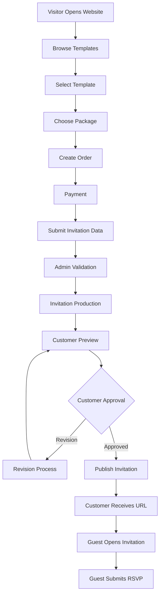

---

# 2. Visitor Flow

## 2.1. Visitor Journey

Visitor merupakan pengguna yang mengakses website tanpa melakukan login.

Tujuan visitor adalah menemukan layanan dan memilih template yang sesuai.

### Main Flow

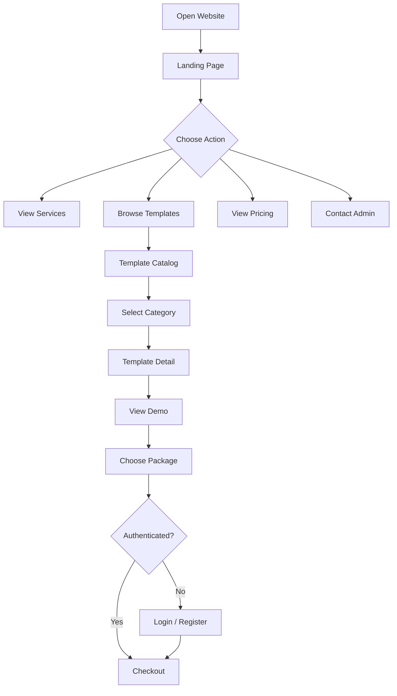

## 2.2. Visitor Activities

| Page | Activity | Expected Result |
|---|---|---|
| Landing Page | Melihat informasi layanan | Memahami produk |
| Services | Melihat layanan | Memahami cakupan jasa |
| Templates | Menjelajahi template | Menemukan desain |
| Category | Memilih kategori | Melihat template terkait |
| Template Detail | Melihat detail desain | Menilai template |
| Template Demo | Melihat contoh undangan | Memahami hasil akhir |
| Pricing | Melihat harga | Membandingkan paket |
| Contact | Menghubungi admin | Mendapatkan informasi |

## 2.3. Template Selection Flow

1. Visitor membuka katalog template.
2. Visitor memilih kategori.
3. Sistem menampilkan template aktif.
4. Visitor membuka detail template.
5. Sistem menampilkan gambar, deskripsi, dan demo.
6. Visitor memilih paket layanan.
7. Sistem mengarahkan visitor ke proses checkout.

## 2.4. Authentication Flow

Jika visitor belum login:

1. Sistem mengarahkan visitor ke login atau registrasi.
2. Visitor mengisi email dan password.
3. Supabase Auth melakukan autentikasi.
4. Sistem membuat atau mengambil profil customer.
5. Sistem mengembalikan customer ke checkout.
6. Sistem mempertahankan template dan paket yang telah dipilih.

**Important:** Data checkout sementara harus dipertahankan ketika pengguna berpindah ke halaman login atau registrasi.

---

# 3. Customer Flow

## 3.1. Customer Journey

Customer merupakan pengguna yang telah memiliki akun dan melakukan pemesanan layanan.

Customer bertanggung jawab atas:
- Pemilihan template.
- Pemilihan paket.
- Pembayaran.
- Pengiriman informasi acara.
- Pengunggahan media.
- Pemeriksaan preview.
- Persetujuan hasil produksi.
- Distribusi URL undangan.

## 3.2. Customer Dashboard

Setelah login, customer diarahkan ke dashboard.

Informasi yang ditampilkan:

| Component | Description |
|---|---|
| Welcome Section | Sapaan customer |
| Active Orders | Jumlah pesanan aktif |
| Completed Orders | Jumlah pesanan selesai |
| Pending Payments | Pesanan menunggu pembayaran |
| Recent Orders | Daftar pesanan terbaru |
| Notifications | Informasi perubahan status |
| Quick Actions | Akses cepat ke pesanan |

## 3.3. Order Creation Flow

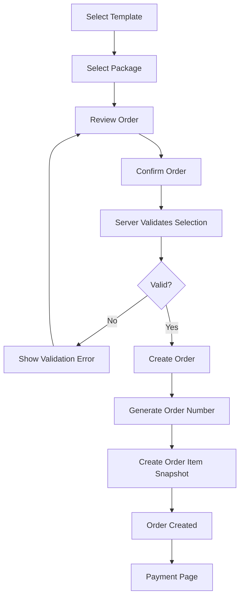

### Detailed Steps

1. Customer memilih template.
2. Customer memilih paket.
3. Sistem menampilkan ringkasan pesanan.
4. Customer memeriksa harga dan fitur.
5. Customer mengonfirmasi pesanan.
6. Server memvalidasi template dan paket.
7. Server menghitung total harga.
8. Sistem membuat order dan order item.
9. Sistem menghasilkan nomor pesanan.
10. Customer diarahkan ke halaman pembayaran.

### Order Summary

Halaman checkout menampilkan:

- Nomor pesanan setelah dibuat.
- Nama template.
- Versi template yang dipilih.
- Nama paket.
- Fitur paket.
- Harga.
- Diskon jika ada.
- Total pembayaran.
- Ketentuan layanan.

Customer tidak dapat menentukan sendiri harga melalui request browser.

---

# 4. Customer Payment Flow

## 4.1. Payment Selection

Customer dapat memilih salah satu metode pembayaran:

1. Transfer bank manual.
2. Payment gateway.

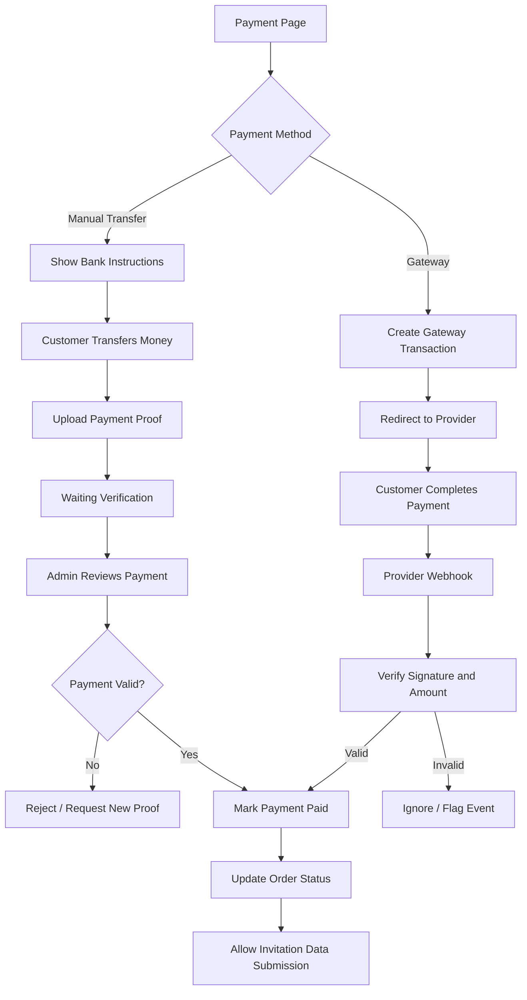

## 4.2. Manual Bank Transfer

### Customer Flow

1. Customer memilih transfer manual.
2. Sistem menampilkan instruksi pembayaran.
3. Customer melakukan transfer.
4. Customer mengunggah bukti pembayaran.
5. Sistem mengubah status pembayaran menjadi `waiting_verification`.
6. Customer menunggu pemeriksaan administrator.

### Admin Flow

1. Admin membuka daftar pembayaran.
2. Admin memilih transaksi.
3. Admin memeriksa bukti transfer.
4. Admin mencocokkan nominal dan informasi pembayaran.
5. Admin menyetujui atau menolak pembayaran.
6. Jika disetujui, sistem mengubah payment menjadi `paid`.
7. Sistem memperbarui order menjadi `paid`.
8. Customer mendapatkan notifikasi.

Jika bukti ditolak, customer dapat mengunggah bukti baru sesuai kebijakan pembayaran.

## 4.3. Payment Gateway

### Customer Flow

1. Customer memilih payment gateway.
2. Server membuat transaksi melalui provider.
3. Customer diarahkan ke halaman pembayaran.
4. Customer menyelesaikan pembayaran.
5. Provider mengirim webhook ke server.
6. Server memvalidasi signature dan informasi transaksi.
7. Server memeriksa nominal serta status transaksi.
8. Server memperbarui status pembayaran.
9. Sistem memberikan notifikasi kepada customer.

### Important Rules

- Jangan menjadikan redirect browser sebagai bukti pembayaran.
- Webhook harus diverifikasi.
- Event duplikat tidak boleh diproses dua kali.
- Nominal transaksi harus dicocokkan.
- Status final harus mengikuti konfirmasi provider.
- Payment yang expired dapat dicoba kembali melalui payment attempt baru.

---

# 5. Invitation Data Submission Flow

## 5.1. Overview

Setelah pembayaran dikonfirmasi, customer dapat mengisi informasi undangan.

Formulir bersifat dinamis berdasarkan kategori template.

Contoh:
- Wedding: informasi kedua mempelai, orang tua, acara, lokasi, galeri, dan cerita.
- Birthday: nama, umur, tanggal, lokasi, dan tema acara.
- Corporate: nama perusahaan, nama acara, jadwal, lokasi, dan informasi registrasi.

## 5.2. Submission Flow

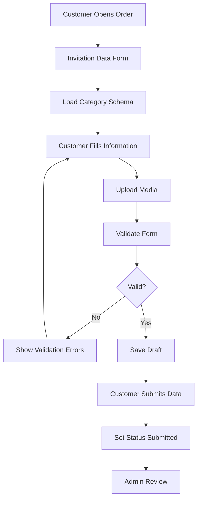

## 5.3. Customer Activities

Customer dapat:
- Mengisi formulir.
- Menyimpan draft.
- Mengubah informasi sebelum dikirim.
- Mengunggah foto.
- Mengunggah audio jika paket mendukung.
- Menambahkan informasi lokasi.
- Mengirim data untuk diperiksa admin.

## 5.4. Form Validation

Sistem memeriksa:

- Field wajib.
- Format tanggal.
- Format waktu.
- Format nomor telepon.
- Ukuran file.
- Jenis file.
- Jumlah foto.
- Kelengkapan data sesuai kategori.
- Fitur yang diperbolehkan oleh paket.

Setelah data dikirim, perubahan data dapat dibatasi sampai admin memberikan akses pengeditan kembali atau proses revisi dilakukan.

---

# 6. Admin Flow

## 6.1. Admin Dashboard

Admin menggunakan dashboard untuk mengelola operasional.

Informasi yang ditampilkan:

| Component | Description |
|---|---|
| Total Orders | Total pesanan |
| Pending Payments | Pembayaran menunggu verifikasi |
| Waiting Data | Customer belum mengirim data |
| New Submissions | Data baru untuk diperiksa |
| In Production | Pesanan sedang dikerjakan |
| Waiting Approval | Preview menunggu persetujuan |
| Revision Requests | Permintaan revisi |
| Published Invitations | Undangan yang telah diterbitkan |

## 6.2. Admin Order Management

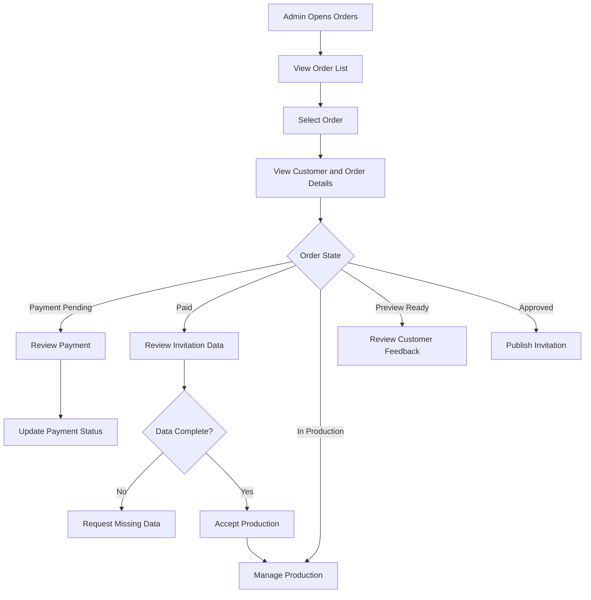

## 6.3. Payment Verification Flow

1. Admin membuka menu pembayaran.
2. Sistem menampilkan transaksi menunggu verifikasi.
3. Admin membuka detail pembayaran.
4. Admin memeriksa bukti transfer.
5. Admin mencocokkan nominal.
6. Admin memilih approve atau reject.
7. Sistem menyimpan identitas administrator.
8. Sistem mencatat riwayat aktivitas.
9. Customer mendapatkan notifikasi.

## 6.4. Invitation Data Review

1. Admin membuka pesanan yang sudah dibayar.
2. Admin membuka data undangan.
3. Admin memeriksa informasi acara.
4. Admin memeriksa foto dan media.
5. Admin menentukan apakah data lengkap.
6. Jika tidak lengkap, admin meminta informasi tambahan.
7. Jika lengkap, admin menyetujui data untuk produksi.

Status data:

```text
draft
submitted
in_review
incomplete
approved
```

## 6.5. Production Workflow

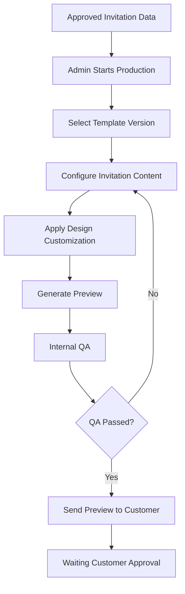

Admin dapat:
- Mengatur konten.
- Menyesuaikan urutan section.
- Menentukan gambar utama.
- Mengatur galeri.
- Mengatur warna atau konfigurasi yang didukung template.
- Memeriksa tampilan mobile dan desktop.
- Memastikan seluruh tautan dan informasi berfungsi.

Admin tidak perlu menggunakan editor drag-and-drop kompleks pada MVP. Konfigurasi dapat dilakukan melalui form dan komponen yang telah disediakan.

## 6.6. Internal Quality Assurance

Sebelum preview dikirim, admin harus memeriksa:

- Nama dan informasi acara.
- Tanggal dan waktu.
- Lokasi dan tautan peta.
- Gambar dan galeri.
- Audio jika tersedia.
- Responsivitas mobile.
- Navigasi undangan.
- RSVP.
- Tidak ada konten placeholder.
- Tidak ada kesalahan visual yang signifikan.

---

# 7. Customer Preview & Revision Flow

## 7.1. Preview Review

Setelah produksi selesai, customer menerima notifikasi bahwa preview telah tersedia.

Customer dapat:
1. Membuka preview.
2. Memeriksa konten.
3. Memeriksa tampilan.
4. Menyetujui hasil.
5. Mengajukan revisi.

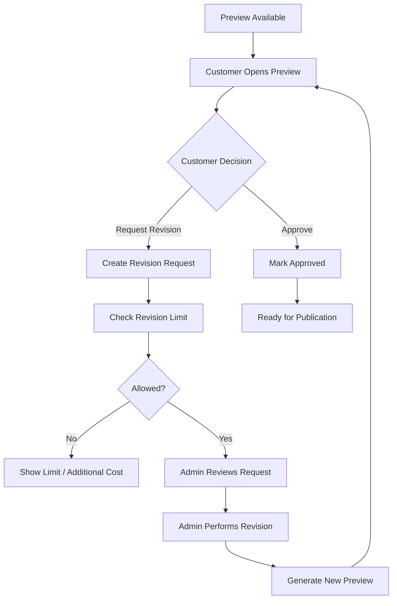

## 7.2. Revision Request

Customer mengisi:
- Bagian yang ingin diubah.
- Penjelasan perubahan.
- Referensi gambar jika diperlukan.
- Lampiran tambahan jika diizinkan.

## 7.3. Revision Rules

- Revisi harus terkait dengan order.
- Setiap revisi memiliki nomor.
- Batas revisi mengikuti paket.
- Admin dapat menerima atau menolak permintaan.
- Perubahan besar di luar ruang lingkup layanan dapat dikenakan biaya tambahan.
- Semua komunikasi harus memiliki riwayat.

## 7.4. Approval

Setelah customer menyetujui preview:

1. Sistem menyimpan waktu persetujuan.
2. Sistem mengubah status produksi menjadi `approved`.
3. Sistem mengizinkan proses publikasi.
4. Admin dapat melanjutkan ke tahap publication.

Persetujuan harus dilakukan melalui tindakan eksplisit, bukan hanya karena customer membuka halaman preview.

---

# 8. Invitation Publication Flow

## 8.1. Publication Process

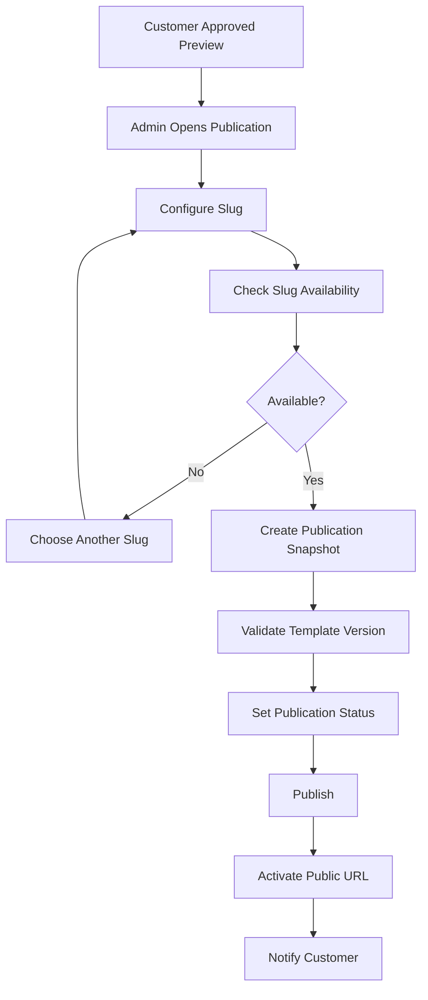

## 8.2. Publication Rules

Sebelum publikasi:

- Order harus memenuhi ketentuan pembayaran.
- Customer harus menyetujui preview.
- Data undangan harus lengkap.
- Template version harus valid.
- Slug harus unik.
- Snapshot konten harus dibuat.

## 8.3. Customer Receives Invitation URL

Contoh:

```text
https://domain.com/bergas-nadia
```

Customer dapat:
- Menyalin URL.
- Membagikan melalui WhatsApp.
- Membagikan melalui media sosial.
- Melihat undangan yang sudah aktif.
- Mengakses statistik jika paket mendukungnya.

---

# 9. Guest Flow

## 9.1. Guest Journey

Guest adalah orang yang menerima tautan undangan.

Guest tidak harus memiliki akun.

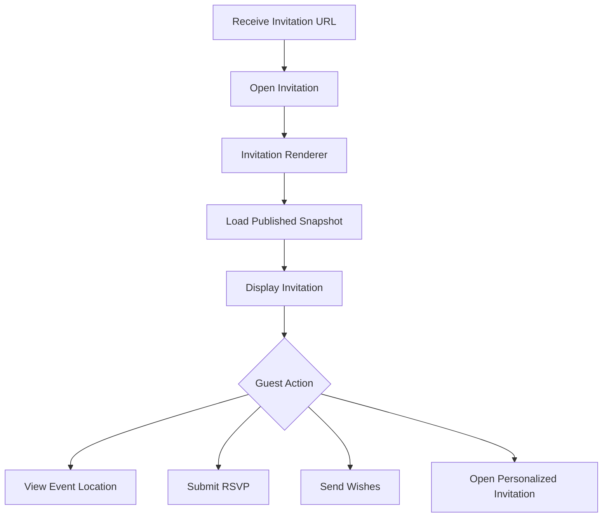

## 9.2. Invitation Viewing

Guest dapat:
- Membuka undangan.
- Melihat informasi acara.
- Melihat galeri.
- Melihat cerita atau informasi tambahan.
- Membuka lokasi melalui Google Maps.
- Mengakses informasi kontak yang disediakan.

## 9.3. RSVP Flow

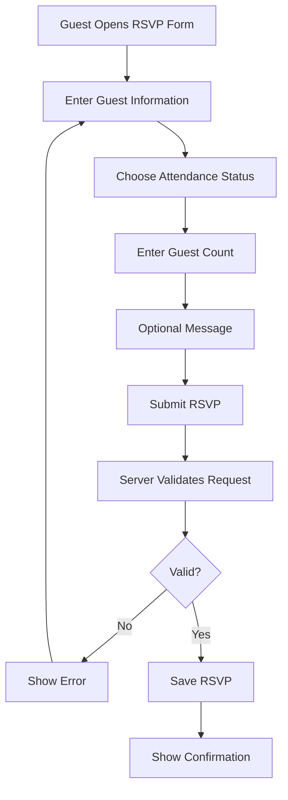

Informasi RSVP:

- Nama tamu.
- Status kehadiran.
- Jumlah tamu.
- Ucapan atau pesan.

Aturan:
- RSVP hanya berlaku untuk publikasi yang valid.
- Jumlah kehadiran harus positif.
- RSVP dapat dibatasi berdasarkan token tamu.
- Endpoint harus memiliki rate limiting.
- Customer dapat melihat ringkasan RSVP milik undangannya.

---

# 10. Super Admin Flow

Super Admin bertanggung jawab atas konfigurasi sistem dan pengelolaan administrator.

## 10.1. Main Activities

- Membuat akun admin.
- Mengubah role pengguna yang berwenang.
- Mengaktifkan atau menonaktifkan akun.
- Mengelola konfigurasi pembayaran.
- Mengelola konfigurasi sistem.
- Melihat audit log.
- Mengelola kategori dan paket.
- Memantau seluruh aktivitas operasional.

## 10.2. Administrator Management

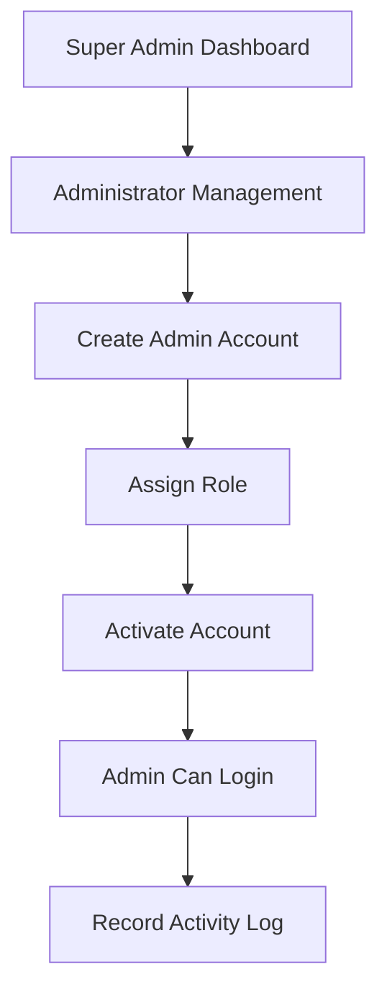

Perubahan role harus dilakukan melalui proses server-side yang terotorisasi.

---

# 11. Alternative & Exception Flows

Sistem harus menangani kondisi yang tidak mengikuti alur utama.

## 11.1. Payment Failed

1. Customer melakukan pembayaran.
2. Provider menyatakan pembayaran gagal atau expired.
3. Sistem mengubah status payment.
4. Order tetap tersimpan.
5. Customer dapat mencoba pembayaran kembali jika order masih berlaku.

## 11.2. Manual Payment Rejected

1. Customer mengunggah bukti transfer.
2. Admin memeriksa bukti.
3. Admin menolak bukti karena tidak valid.
4. Sistem menyimpan alasan penolakan.
5. Customer menerima notifikasi.
6. Customer dapat mengunggah ulang bukti.

## 11.3. Invitation Data Incomplete

1. Customer mengirim data.
2. Admin melakukan pemeriksaan.
3. Admin menemukan data yang belum lengkap.
4. Status data menjadi `incomplete`.
5. Admin menyampaikan informasi yang dibutuhkan.
6. Customer melengkapi data.
7. Customer mengirim ulang data.

## 11.4. Customer Does Not Approve Preview

1. Customer membuka preview.
2. Customer menemukan ketidaksesuaian.
3. Customer mengajukan revisi.
4. Sistem memeriksa batas revisi.
5. Admin mengerjakan revisi.
6. Preview baru dibuat.
7. Customer memeriksa kembali.

## 11.5. Slug Already Exists

1. Admin memasukkan slug.
2. Server memeriksa ketersediaan.
3. Slug sudah digunakan.
4. Sistem menolak publikasi.
5. Admin memilih slug alternatif.

## 11.6. Publication Expired

1. Masa aktif undangan berakhir.
2. Sistem menandai publikasi sebagai expired.
3. Undangan tidak lagi ditampilkan sebagai publikasi aktif.
4. Customer dapat menghubungi admin untuk perpanjangan jika layanan mendukungnya.

Perubahan status expired sebaiknya dilakukan melalui scheduled job atau proses backend yang terjadwal, bukan hanya ketika halaman dibuka.

## 11.7. Duplicate Payment Webhook

1. Provider mengirim webhook.
2. Server memeriksa event ID.
3. Event ternyata sudah pernah diproses.
4. Server tidak mengulangi perubahan status.
5. Server mengembalikan respons sesuai kontrak provider.

---

# 12. Notification Flow

Sistem memberikan notifikasi ketika terjadi perubahan penting.

| Event | Recipient | Notification |
|---|---|---|
| ORDER_CREATED | Customer | Pesanan berhasil dibuat |
| PAYMENT_CONFIRMED | Customer | Pembayaran berhasil |
| PAYMENT_REJECTED | Customer | Bukti pembayaran ditolak |
| DATA_SUBMITTED | Admin | Data undangan masuk |
| DATA_INCOMPLETE | Customer | Data perlu dilengkapi |
| PRODUCTION_STARTED | Customer | Produksi dimulai |
| PREVIEW_READY | Customer | Preview tersedia |
| REVISION_REQUESTED | Admin | Revisi baru |
| REVISION_COMPLETED | Customer | Revisi selesai |
| INVITATION_PUBLISHED | Customer | Undangan berhasil dipublikasikan |
| INVITATION_EXPIRING | Customer | Masa aktif hampir berakhir |

## 12.1. Notification Channels

Tahap awal:
- Customer dashboard.
- Admin dashboard.
- Email.
- WhatsApp melalui tautan manual.

Pengembangan lanjutan:
- WhatsApp Business API.
- Push notifications.
- Notification preferences.

---

# 13. Main Status Transitions

Setiap domain memiliki lifecycle masing-masing.

## 13.1. Order Status

```text
pending_payment
    |
    v
paid
    |
    v
processing
    |
    v
completed
```

Status alternatif:
- cancelled
- expired

## 13.2. Payment Status

```text
pending
   |
   +--> waiting_verification
   |          |
   |          +--> paid
   |          |
   |          +--> failed
   |
   +--> paid
   |
   +--> failed
   |
   +--> expired
   |
   +--> refunded
```

## 13.3. Production Status

```text
waiting_data
    |
    v
data_review
    |
    v
queued
    |
    v
in_progress
    |
    v
preview_ready
    |
    +--> revision_requested
    |           |
    |           v
    |       in_progress
    |
    v
approved
    |
    v
completed
```

## 13.4. Publication Status

```text
draft
  |
  v
published
  |
  +--> unpublished
  |
  +--> expired
```

Status transition harus dikontrol oleh business logic dan tidak boleh ditentukan bebas oleh browser.

---

# 14. UI/UX Flow Requirements

Setiap halaman harus memberikan informasi yang jelas mengenai status dan tindakan berikutnya.

## 14.1. Customer Experience

Customer harus dapat mengetahui:

- Pesanan sedang berada pada tahap apa.
- Apakah pembayaran telah dikonfirmasi.
- Apakah data undangan sudah lengkap.
- Apakah admin sedang mengerjakan undangan.
- Apakah preview sudah tersedia.
- Berapa revisi yang tersisa.
- Apakah undangan sudah dipublikasikan.

## 14.2. Admin Experience

Admin harus dapat mengetahui:

- Pesanan baru.
- Pembayaran yang perlu diperiksa.
- Data yang belum lengkap.
- Produksi yang sedang berjalan.
- Preview yang menunggu persetujuan.
- Revisi yang perlu ditangani.
- Publikasi yang perlu dilakukan.

## 14.3. Guest Experience

Guest harus dapat:

- Membuka undangan dengan cepat.
- Membaca informasi acara dengan jelas.
- Mengakses lokasi.
- Mengisi RSVP dengan mudah.
- Menggunakan halaman undangan melalui perangkat mobile.

---

# 15. Flow Validation Checklist

## Visitor

- [ ] Visitor dapat membuka website.
- [ ] Visitor dapat melihat kategori.
- [ ] Visitor dapat melihat template.
- [ ] Visitor dapat melihat demo.
- [ ] Pilihan template tetap tersimpan saat login.

## Customer

- [ ] Customer dapat membuat order.
- [ ] Customer dapat melihat order sendiri.
- [ ] Customer dapat melakukan pembayaran.
- [ ] Customer dapat mengirim data undangan.
- [ ] Customer dapat mengunggah media.
- [ ] Customer dapat melihat preview.
- [ ] Customer dapat meminta revisi.
- [ ] Customer dapat menyetujui hasil.
- [ ] Customer dapat mengakses URL publikasi.

## Admin

- [ ] Admin dapat melihat daftar pesanan.
- [ ] Admin dapat memverifikasi pembayaran manual.
- [ ] Admin dapat memeriksa data undangan.
- [ ] Admin dapat melakukan produksi.
- [ ] Admin dapat mengirim preview.
- [ ] Admin dapat mengelola revisi.
- [ ] Admin dapat memublikasikan undangan.

## Guest

- [ ] Guest dapat membuka undangan.
- [ ] Guest dapat melihat informasi acara.
- [ ] Guest dapat membuka lokasi.
- [ ] Guest dapat mengirim RSVP.
- [ ] Guest tidak dapat mengakses data privat customer.

## Exception Handling

- [ ] Pembayaran gagal ditangani.
- [ ] Bukti transfer ditolak dapat diunggah ulang.
- [ ] Data tidak lengkap dapat dikembalikan.
- [ ] Revisi melebihi batas ditangani.
- [ ] Slug duplikat ditolak.
- [ ] Webhook duplikat tidak diproses ulang.
- [ ] Undangan expired tidak ditampilkan sebagai publikasi aktif.

---

# 16. Related Documentation

| File | Description |
|---|---|
| `system-doc.md` | Arsitektur keseluruhan sistem |
| `database-schema.md` | Struktur database dan relasi |
| `api-documentation.md` | API dan kontrak request/response |
| `security.md` | Authentication, authorization, dan keamanan |
| `deployment.md` | Environment, CI/CD, dan deployment |
| `development-roadmap.md` | Tahapan implementasi |
| `README.md` | Instalasi dan cara menjalankan project |

---

**End of Document**
